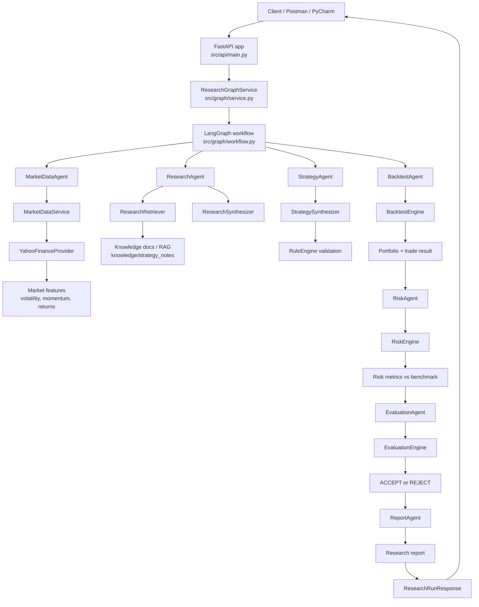
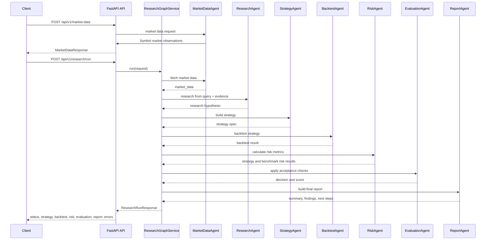

# AI Quant Research Agent - Flow Diagrams

## 1) Overall System Flow



## 2) REST API Call Flow



## 3) Simple Text Version

```text
Client
  |
  v
FastAPI API
  |
  v
ResearchGraphService
  |
  +--> MarketDataAgent --> MarketDataService --> YahooFinanceProvider
  |
  +--> ResearchAgent --> RAG Retriever --> knowledge/strategy_notes/*.md
  |
  +--> StrategyAgent --> RuleEngine
  |
  +--> BacktestAgent --> BacktestEngine
  |
  +--> RiskAgent --> RiskEngine --> Strategy and benchmark metrics
  |
  +--> EvaluationAgent --> ACCEPT or REJECT decision
  |
  +--> ReportAgent --> Final research report
  |
  v
ResearchRunResponse
```

## 4) Quick Project Summary

This project is a research-to-report pipeline. It fetches market data, retrieves relevant knowledge from the local RAG corpus, synthesizes a research hypothesis, converts it into a strategy DSL, runs a deterministic backtest, calculates strategy and benchmark risk metrics, decides whether the strategy passes objective acceptance checks, and produces a final research report.
