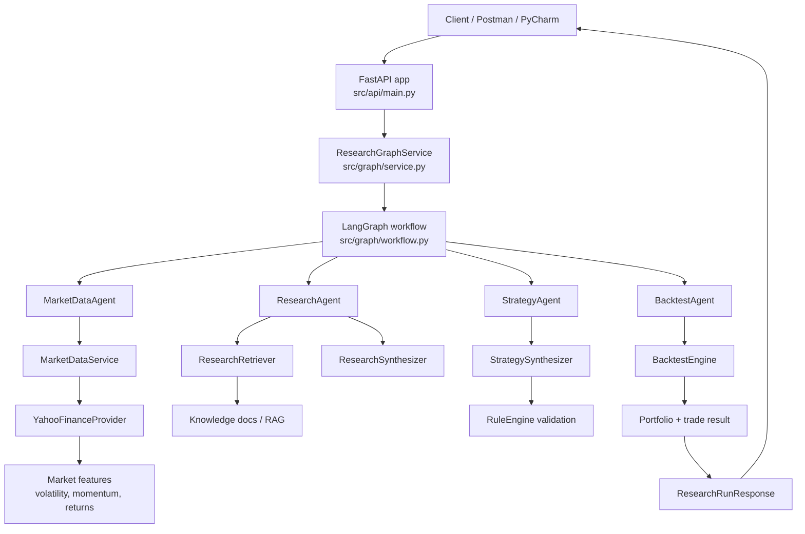
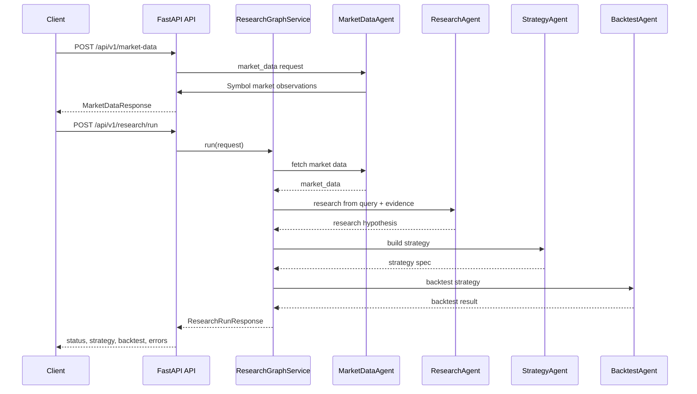

Searched for regex `market-data|research/run|client.post\(|requests.post\(` (`**/tests/**`), 1 result

Read 

## 🔎 Project analysis

This project is a FastAPI-based quantitative research pipeline built around a LangGraph workflow. The main entrypoint is `main.py`, and the orchestration is defined in `workflow.py`.

The real pipeline flow is:

- API receives request
- Market data is downloaded and feature-enriched
- Research agent retrieves evidence from local knowledge docs
- Strategy agent translates research into a strategy DSL
- Backtest engine evaluates the strategy deterministically
- Response is returned as structured JSON

The core models live in:
- `market_data.py`
- `research.py`
- `strategy.py`
- `backtest.py`

---

## 🧭 Overall flow diagram



---

## 🌐 REST API call diagram



---

## 🧩 Brief description of the project

This is a research-to-backtest engine for trading ideas.

### 1) Market data layer
- `provider.py` fetches price data from Yahoo Finance.
- `service.py` enriches data with:
  - simple return
  - log return
  - volatility
  - momentum
  - SMA values

#### Quant feature formulas used in the project

The pricing feature engineering is implemented in `src/quant/features.py` and is used before research and backtesting.

1. Simple return

   The simple return measures the percentage move from one period to the next:

   $$
   R_t = \frac{P_t}{P_{t-1}} - 1
   $$

   Intuition: if price rises from 100 to 105, then $R_t = 0.05$, meaning a 5% gain.

2. Log return

   Log returns are used because they are additive across time and easier to model statistically:

   $$
   r_t = \ln\left(\frac{P_t}{P_{t-1}}\right)
   $$

   Intuition: instead of looking at percentage change directly, we convert it to a continuously compounded return. This makes multi-period aggregation cleaner and often more stable for volatility calculations.

3. Rolling volatility

   Volatility captures how much the asset moves over a recent lookback window:

   $$
   \sigma_t = \text{std}(r_{t-N+1}, \ldots, r_t) \times \sqrt{252}
   $$

   where $N$ is the `volatility_window` and 252 is the standard annualization factor for trading days.

   Intuition: if log returns are very dispersed over the last 20 days, the strategy sees higher uncertainty and more risk. This is useful for filtering entries when the market is unstable.

4. Momentum

   Momentum measures how much the price has changed over a longer horizon:

   $$
   M_t(N) = \frac{P_t}{P_{t-N}} - 1
   $$

   Intuition: if price is much higher than it was $N$ periods ago, the asset may be trending upward. This is the core signal used by many trend-following systems.

5. Simple moving averages

   The moving averages smooth noisy price data:

   $$
   SMA_{20,t} = \frac{1}{20} \sum_{i=0}^{19} P_{t-i}
   $$

   $$
   SMA_{50,t} = \frac{1}{50} \sum_{i=0}^{49} P_{t-i}
   $$

   Intuition: short- and medium-term moving averages help detect whether price is above or below its recent trend. Strategy rules often use this to confirm trend direction and filter weak setups.

#### Why these features matter in this project

These features are not arbitrary—they are the deterministic signals used before creating a research hypothesis and before running a backtest. They help answer questions like:

- Is the asset trending upward?
- Is volatility high or low?
- Are recent returns strong enough to justify a trade?
- Is the price above or below its recent average?

These are exactly the inputs that the research and strategy agents can later turn into rule-based trading logic.

### 2) Research layer
- `research_agent.py` retrieves relevant evidence via RAG.
- `rag` contains chunking, embeddings, retrieval, vector store logic.
- LLM synthesis produces a structured research hypothesis.

### 3) Strategy layer
- `strategy_agent.py` creates a strategy spec.
- `rule_engine.py` validates the strategy DSL.

### 4) Backtest layer
- `engine.py` does deterministic backtesting.
- It calculates:
  - equity curve
  - total return
  - benchmark return
  - trade records
  - per-symbol metrics

### 5) API layer
- `main.py` exposes:
  - GET /health
  - POST /api/v1/market-data
  - POST /api/v1/research/run

---

## 🧪 API payloads for debugging

### A. Market data endpoint

Endpoint:
- POST /api/v1/market-data

Request JSON:

```json
{
  "symbols": ["AAPL", "MSFT", "NVDA"],
  "start_date": "2025-01-01",
  "end_date": "2025-03-01",
  "volatility_window": 20,
  "momentum_window": 20
}
```

Expected response shape:

```json
{
  "data": [
    {
      "symbol": "AAPL",
      "observations": [
        {
          "date": "2025-01-01",
          "open": 100.0,
          "high": 101.2,
          "low": 99.8,
          "close": 100.5,
          "volume": 1200000.0,
          "simple_return": 0.0,
          "log_return": 0.0,
          "volatility": null,
          "momentum": null,
          "sma_20": null,
          "sma_50": null
        }
      ]
    }
  ]
}
```

This is defined by `market_data.py`.

---

### B. Research run endpoint

Endpoint:
- POST /api/v1/research/run

Request JSON:

```json
{
  "query": "Find a momentum strategy for AAPL",
  "symbols": ["AAPL"],
  "start_date": "2025-01-01",
  "end_date": "2025-03-01",
  "volatility_window": 20,
  "momentum_window": 20,
  "top_k": 3,
  "slippage_bps": 2.0,
  "initial_capital": 100000.0
}
```

Expected response shape:

```json
{
  "research_id": "uuid-string",
  "status": "BACKTEST_READY",
  "current_agent": "backtest",
  "iteration": 4,
  "market_data": {
    "symbols": {
      "AAPL": {
        "observation_count": 60,
        "first_date": "2025-01-01",
        "last_date": "2025-03-01",
        "latest": {
          "close": 123.45,
          "volatility": 0.0123,
          "momentum": 0.045
        }
      }
    }
  },
  "research": {
    "hypothesis": "Momentum strategies work when volatility is subdued and trend remains positive.",
    "rationale": "The strategy follows trend continuation while filtering unstable periods.",
    "features": ["momentum", "volatility"],
    "assets": ["AAPL"],
    "risks": ["trend reversal", "regime change"],
    "evidence": [],
    "confidence": 0.82
  },
  "strategy": {
    "name": "VolatilityFilteredMomentum",
    "description": "Long-only momentum strategy",
    "assets": ["AAPL"],
    "direction": "long_only",
    "entry": {
      "logic": "all",
      "conditions": [
        {
          "feature": "momentum",
          "operator": ">=",
          "value": 0.01
        }
      ]
    },
    "exit": {
      "logic": "any",
      "conditions": [
        {
          "feature": "momentum",
          "operator": "<",
          "value": 0.0
        }
      ]
    },
    "position_sizing": {
      "method": "fixed_fraction",
      "fraction": 1.0
    },
    "transaction_cost_bps": 5.0,
    "rationale": "Trend-following logic with volatility filter",
    "research_confidence": 0.82
  },
  "backtest": {
    "strategy_name": "VolatilityFilteredMomentum",
    "symbols": ["AAPL"],
    "transaction_cost_bps": 5.0,
    "slippage_bps": 2.0,
    "initial_capital": 100000.0,
    "final_equity": 110000.0,
    "benchmark_final_equity": 98000.0,
    "total_return": 0.1,
    "benchmark_return": -0.02,
    "excess_return": 0.12,
    "equity_curve": [],
    "trades": [],
    "per_symbol": [],
    "diagnostics": {}
  },
  "errors": []
}
```

This is defined in `research.py`.

---

## ✅ Best payload to start debugging

Use this first:

```json
{
  "query": "Find a momentum strategy for AAPL",
  "symbols": ["AAPL"],
  "start_date": "2025-01-01",
  "end_date": "2025-03-01",
  "volatility_window": 20,
  "momentum_window": 20,
  "top_k": 3,
  "slippage_bps": 2.0,
  "initial_capital": 100000.0
}
```

This is the simplest request that exercises the full pipeline:
- market data
- research retrieval
- strategy synthesis
- deterministic backtest

---

## 🚀 Good debugging strategy

If you want to debug in PyCharm, start with:
1. Breakpoint in `main.py`
2. Breakpoint in `service.py`
3. Breakpoint in `market_data_agent.py`
4. Breakpoint in `research_agent.py`
5. Breakpoint in `strategy_agent.py`
6. Breakpoint in `backtest_agent.py`

This will let you inspect the state transition between each stage.

If you want, I can next produce:
- a full PyCharm debug configuration for this exact project
- a ready-made Postman collection
- or a step-by-step debugger walkthrough for each API request.