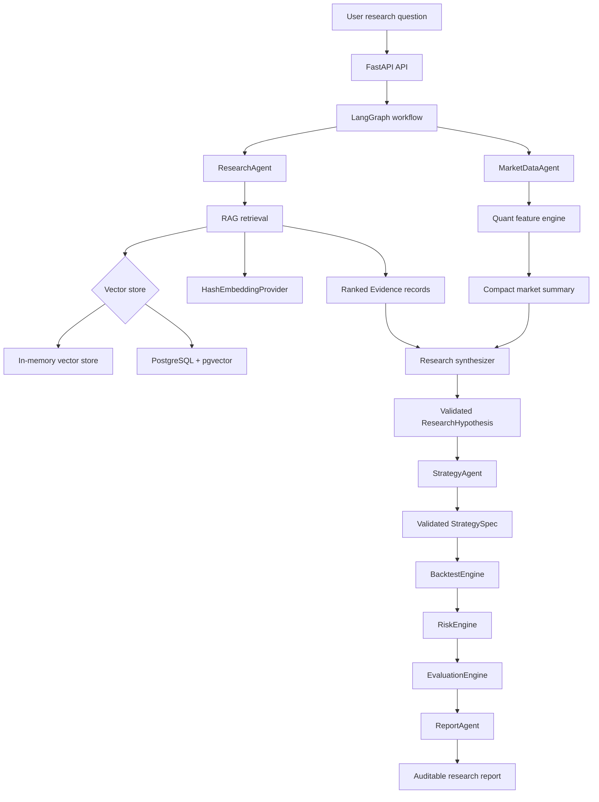
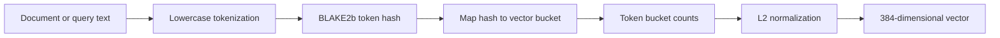
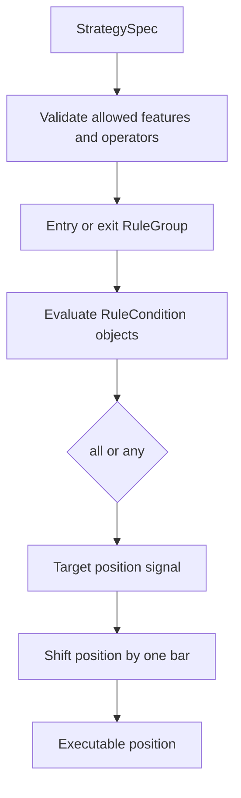
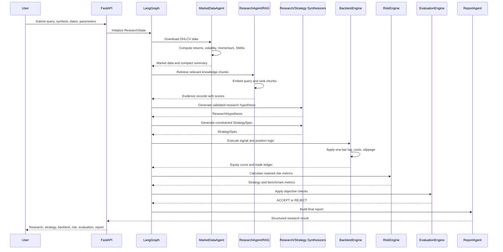

# Machine Learning and Algorithm Architecture

This document inventories the algorithms actually used by the AI Quant Research Agent Platform, explains the end-to-end flow, and gives practical use cases.

## 1. Executive Summary

The project is an AI-assisted quantitative research platform. It is not currently a conventional supervised machine-learning system that trains models from labeled historical data.

The implemented intelligence is composed of four categories:

1. **Retrieval and embeddings** for finding relevant research evidence.
2. **Optional LLM synthesis** for producing structured research hypotheses and strategy specifications.
3. **Deterministic quantitative algorithms** for market features, backtesting, and risk analytics.
4. **Rule-based evaluation** for accepting or rejecting a strategy against objective thresholds.

The repository contains planned references to scikit-learn, PyTorch, SciPy, statsmodels, and `arch`, but no trained scikit-learn, PyTorch, or deep-learning model is currently used in the execution path.

## 2. What Is Actually Implemented?

| Category | Algorithm or component | Status | Main location |
|---|---|---|---|
| Text embedding | Hash-based token embedding, 384 dimensions by default | Implemented | `ai-engine/src/rag/embeddings.py` |
| Vector retrieval | Cosine similarity over in-memory vectors | Implemented | `ai-engine/src/rag/vector_store.py` |
| Vector retrieval | PostgreSQL/pgvector cosine-distance search | Implemented as optional mode | `ai-engine/src/rag/vector_store.py` |
| LLM synthesis | OpenAI structured-output research synthesizer | Optional, implemented | `ai-engine/src/llm/research_synthesizer.py` |
| LLM strategy generation | OpenAI structured-output StrategySpec generator | Optional, implemented | `ai-engine/src/llm/strategy_synthesizer.py` |
| Offline synthesis | Deterministic research and strategy synthesizers | Implemented fallback | `ai-engine/src/llm/` |
| Return calculation | Simple and logarithmic returns | Implemented | `ai-engine/src/quant/features.py` |
| Volatility | Rolling annualized standard deviation of log returns | Implemented | `ai-engine/src/quant/features.py` |
| Momentum | Price change over a configurable lookback | Implemented | `ai-engine/src/quant/features.py` |
| Trend features | 20-day and 50-day simple moving averages | Implemented | `ai-engine/src/quant/features.py` |
| Strategy logic | Constrained rule DSL with boolean groups and comparisons | Implemented | `ai-engine/src/strategy/rule_engine.py` |
| Backtesting | One-bar-lag long-only portfolio backtest with costs | Implemented | `ai-engine/src/backtesting/engine.py` |
| Risk analytics | CAGR, volatility, Sharpe, Sortino, drawdown, VaR, ES, turnover, exposure | Implemented | `ai-engine/src/risk/engine.py` |
| Evaluation | Deterministic threshold-based acceptance checks | Implemented | `ai-engine/src/evaluation/engine.py` |
| scikit-learn models | Random forest, regression, clustering, etc. | Not implemented | Listed in planning only |
| PyTorch/deep learning | Neural networks, LSTM, transformers, etc. | Not implemented | Listed in planning only |
| Reinforcement learning | Policy/value learning | Not implemented | Not present in source |

## 3. High-Level System Flow



## 4. RAG and Embedding Algorithm

### 4.1 Document processing

The RAG corpus is loaded from `ai-engine/knowledge/`. The loader supports Markdown and PDF documents:

1. Discover files recursively.
2. Extract text.
3. Preserve source metadata.
4. Normalize whitespace.
5. Split each document into overlapping chunks.
6. Embed each chunk.
7. Store chunks and vectors.

The default chunk configuration is 900 characters with 120 characters of overlap.

### 4.2 Hash-based embedding

`HashEmbeddingProvider` is a deterministic local embedding algorithm. It is not a neural language model.

For each input text:

1. Tokenize lower-case words using a regular expression.
2. Hash every token with BLAKE2b.
3. Map each hash into one of 384 vector buckets.
4. Increment the selected bucket.
5. L2-normalize the vector.

This creates a fixed-length vector suitable for local similarity search.



The benefit is reproducible offline behavior. The limitation is that tokens with similar meanings do not necessarily receive similar representations. Production semantic search should replace this provider with a trained embedding model while retaining the same `EmbeddingProvider` interface.

### 4.3 Similarity search

For a query vector $q$ and chunk vector $v$, the in-memory store uses cosine similarity:

$$
\text{similarity}(q, v) = \frac{q \cdot v}{\|q\|\|v\|}
$$

The highest-scoring chunks are returned as `Evidence` records. In PostgreSQL mode, pgvector performs the equivalent cosine-distance ordering with the `<=>` operator.

## 5. Optional LLM Algorithms

The project can use OpenAI structured outputs when `OPENAI_API_KEY` is present.

### Research synthesis

`OpenAIResearchSynthesizer` receives:

- User query
- Symbols
- Compact market summary
- Retrieved evidence

It must return a Pydantic-validated `ResearchHypothesis` containing:

- Hypothesis
- Rationale
- Features
- Assets
- Risks
- Evidence
- Confidence

Without an API key, `DeterministicResearchSynthesizer` provides an offline fallback.

### Strategy synthesis

`OpenAIStrategySynthesizer` converts the research hypothesis into a constrained `StrategySpec`. It is explicitly prevented from generating executable code and is limited to allowed market features and operators.

Without an API key, `DeterministicStrategySynthesizer` creates the current default strategy:

```text
VolatilityFilteredMomentum

Entry:
- momentum > 0.05
- close > sma_50
- volatility < 0.35

Exit:
- momentum < 0.0
  OR
- close < sma_50
```

The LLMs do not calculate portfolio returns or risk metrics. Those calculations remain deterministic.

## 6. Quantitative Algorithms

### 6.1 Simple return

For price $P_t$:

$$
R_t = \frac{P_t}{P_{t-1}} - 1
$$

Implemented with `pandas.Series.pct_change()`.

### 6.2 Log return

$$
 r_t = \ln\left(\frac{P_t}{P_{t-1}}\right)
$$

Used as the basis for rolling volatility.

### 6.3 Annualized rolling volatility

For lookback window $N$ and 252 trading periods per year:

$$
\sigma_t = \operatorname{std}(r_{t-N+1}, ..., r_t) \sqrt{252}
$$

Implemented with a rolling pandas standard deviation and NumPy annualization.

### 6.4 Momentum

$$
M_t(N) = \frac{P_t}{P_{t-N}} - 1
$$

The default momentum lookback is 20 periods.

### 6.5 Simple moving averages

The project calculates:

$$
SMA_{20,t} = \frac{1}{20}\sum_{i=0}^{19}P_{t-i}
$$

and:

$$
SMA_{50,t} = \frac{1}{50}\sum_{i=0}^{49}P_{t-i}
$$

These features are available to the strategy DSL.

## 7. Strategy Algorithm

The strategy layer is a constrained rule engine, not a trained machine-learning model.

A strategy contains entry and exit `RuleGroup` objects. A group uses either `all` or `any` logic. Each condition compares a permitted feature with either a numeric value or another permitted feature.



Allowed features include:

```text
open, high, low, close, volume
simple_return, log_return
volatility, momentum
sma_20, sma_50
```

The rule engine rejects unsupported features before backtesting.

## 8. Backtesting Algorithms

The backtester is deterministic and long-only.

### One-bar execution lag

A signal generated at bar $t$ is executed at bar $t+1$:

$$
position_t = target\_position_{t-1}
$$

This prevents the strategy from using the current bar's closing information and earning the same bar's return.

### Costs

Turnover is:

$$
turnover_t = |position_t - position_{t-1}|
$$

Transaction and slippage costs are:

$$
transaction\_cost_t = turnover_t \times \frac{transaction\_cost\_bps}{10000}
$$

$$
slippage\_cost_t = turnover_t \times \frac{slippage\_bps}{10000}
$$

Net strategy return is:

$$
R_{strategy,t} = position_t R_t - transaction\_cost_t - slippage\_cost_t
$$

Multiple assets are combined with equal-weight averaging of per-symbol returns.

## 9. Risk Algorithms

`RiskEngine` calculates metrics from realized strategy and benchmark equity curves.

Implemented metrics:

- CAGR
- Annualized volatility
- Sharpe ratio
- Sortino ratio
- Maximum drawdown
- Historical VaR
- Historical Expected Shortfall
- Total turnover
- Average daily turnover
- Average and maximum gross exposure
- Percentage of days in the market

The benchmark is a fully invested equal-weight buy-and-hold portfolio over the same assets.

### Risk-adjusted metrics

The engine derives a daily risk-free rate from the annual rate, then calculates excess returns.

Sharpe ratio:

$$
Sharpe = \frac{annualized\ mean\ excess\ return}{annualized\ volatility}
$$

Sortino uses downside deviation instead of total volatility.

Maximum drawdown is calculated from the running equity peak:

$$
Drawdown_t = \frac{Equity_t}{RunningPeak_t} - 1
$$

Historical VaR uses the lower return quantile at the selected confidence level. Expected Shortfall is the mean of returns in that lower tail.

## 10. Evaluation Algorithm

`EvaluationEngine` performs deterministic acceptance checks. It does not learn thresholds from data.

Current checks include:

1. Strategy Sharpe beats the benchmark.
2. Maximum drawdown is within the configured limit.
3. CAGR exceeds the minimum.
4. Expected Shortfall is within the limit.
5. The backtest contains enough trades.
6. Average daily turnover is reasonable.
7. Total return beats the benchmark with positive risk-adjusted performance.

The score is:

$$
score = \frac{number\ of\ passed\ checks}{number\ of\ checks}
$$

The result is `ACCEPT` only when no check fails; otherwise it is `REJECT`.

## 11. Complete Execution Sequence



## 12. Practical Use Cases

### Use case 1: Momentum strategy research

**Question:**

```text
Find a momentum strategy for AAPL, MSFT, and NVDA with a volatility filter.
```

**System behavior:**

1. Download historical prices.
2. Calculate momentum, volatility, returns, and moving averages.
3. Retrieve momentum and volatility research notes.
4. Generate a falsifiable hypothesis.
5. Convert the hypothesis into a constrained rule strategy.
6. Backtest with execution lag and trading costs.
7. Compare against equal-weight buy-and-hold.
8. Calculate risk metrics and accept/reject the result.

**Useful output:**

- Strategy rules
- Evidence sources
- Equity curve
- Trade ledger
- Excess return
- Drawdown and Sharpe
- Evaluation decision

### Use case 2: Compare a strategy against a benchmark

**Question:**

```text
Does a volatility-filtered trend strategy improve risk-adjusted performance over buy-and-hold SPY and QQQ?
```

The system uses the same assets for the strategy and benchmark, then compares total return, Sharpe, drawdown, volatility, and Expected Shortfall.

### Use case 3: Research evidence audit

A researcher can inspect the evidence attached to a generated hypothesis. Each evidence item includes a source ID, title, excerpt, similarity score, and source metadata. This helps identify whether the qualitative strategy claim was grounded in the local research corpus.

### Use case 4: Offline deterministic development

Without an OpenAI API key, PostgreSQL, or external embedding service, the project can run its test path using:

- Deterministic hash embeddings
- In-memory vector search
- Deterministic research synthesis
- Deterministic strategy synthesis
- Fake market-data providers in tests

This makes the core pipeline repeatable and testable offline.

### Use case 5: Production-oriented research service

With PostgreSQL/pgvector and an OpenAI API key configured, the platform can:

- Persist document vectors.
- Retrieve evidence across service restarts.
- Use semantic embedding and LLM providers through replaceable interfaces.
- Preserve deterministic backtesting and risk calculations after the LLM stages.

## 13. What Is Not Yet Implemented

The following technologies appear in the project plan but are not currently algorithms in the execution path:

- scikit-learn predictive models
- Random forests
- Gradient boosting
- Linear or logistic regression training
- Clustering or PCA
- PyTorch models
- LSTM or transformer training
- Reinforcement learning
- Hyperparameter optimization
- Walk-forward model training
- Feature-label datasets for supervised learning
- Model registry and model serving

The current platform is therefore best described as:

> An agent-orchestrated quantitative research and backtesting platform with RAG, optional LLM synthesis, deterministic feature engineering, and rule-based strategy evaluation.

## 14. Test Coverage

The implemented algorithmic layers have focused tests including:

- Feature calculations
- RAG vector retrieval
- Research Agent evidence integration
- Strategy DSL validation
- One-bar backtest execution lag
- Transaction costs and slippage
- Trade ledger generation
- Benchmark construction
- Risk metrics
- Evaluation acceptance checks
- End-to-end LangGraph workflow behavior

Relevant test directories and files are under `ai-engine/tests/`.
